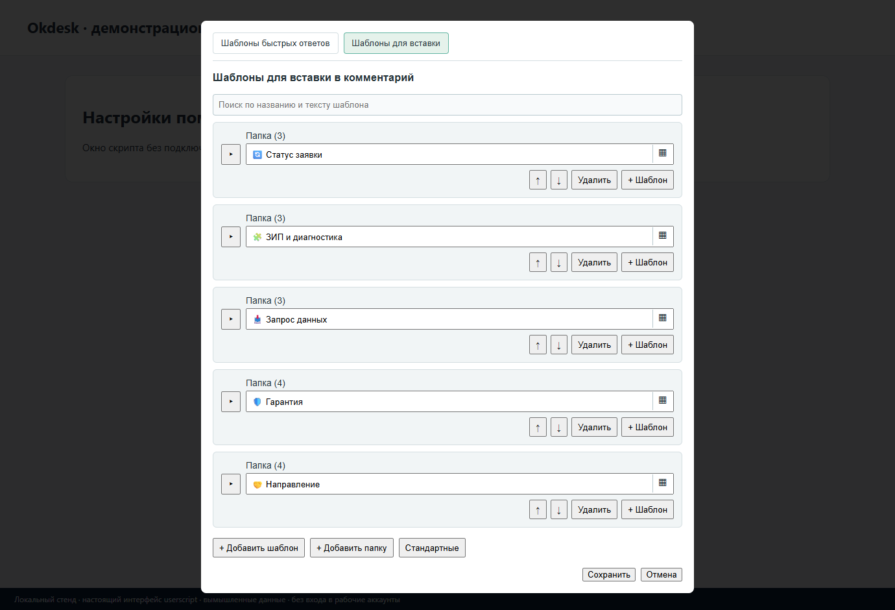

# Okdesk — шаблоны ответов и помощник по заявкам

**Tampermonkey · 1.7.62 · Jeronimo701**

Добавляет в веб-интерфейс Okdesk шаблоны комментариев, быстрые ответы и инструменты для полей заявки. Полезен, когда приходится много раз запрашивать одинаковые данные или передавать обращения коллегам.

[Установить скрипт](https://raw.githubusercontent.com/jeronimo701/Okdesk-field-filler-equipment-title/main/Okdesk_field_filler_equipment_title.user.js) · [Изменения](CHANGELOG.md) · [Сообщить о проблеме](https://github.com/jeronimo701/Okdesk-field-filler-equipment-title/issues)

*Настоящий интерфейс скрипта на локальной тестовой странице, с вымышленными данными. Это не снимок рабочего аккаунта или реального каталога сайта.* [Общие настройки](docs/screenshots/settings.png)

## Что умеет

- Папки шаблонов, поиск, редактирование и перенос настроек через JSON.
- Быстрые ответы и выбор расположения панели в заявке.
- Работа со статусами и передачей ответственного через Okdesk API.
- Префикс оборудования и правила изменения темы заявки.
- Светлая/тёмная тема скрипта и отдельный мобильный режим.

## Установка и первый запуск

1. Установи [Tampermonkey](https://www.tampermonkey.net/) в поддерживаемый браузер.
2. Нажми **«Установить скрипт»** выше и подтверди установку в расширении.
3. Открой свой Okdesk и обнови вкладку.
4. В меню Tampermonkey выбери «Настройки скрипта Okdesk».
5. Настрой шаблоны и быстрые ответы. API-токен вводи только локально и только если он нужен для выбранных действий.
6. Сначала проверь настройки на тестовой заявке: действия API могут менять реальные поля, комментарии и ответственного.

Не включай одновременно несколько старых копий этого скрипта.

## Обновления

Автообновление настроено: `@updateURL` ведёт на небольшой `.meta.js`, `@downloadURL` — на актуальный `.user.js` в этом публичном репозитории. GitHub-вход и токен не нужны.

**Если раньше стояла копия с `@updateURL none`, её нужно один раз переустановить по ссылке выше.** Такая копия сама не узнает новый адрес. `@name` и `@namespace` сохранены; перед переустановкой сделай резервную копию настроек средствами Tampermonkey. Дальше проверь, что автоматическая проверка обновлений включена в расширении; мгновенное уведомление не гарантируется.

[Как устроены updateURL и downloadURL](https://www.tampermonkey.net/documentation.php#meta:updateURL).

## Что важно знать

Часть функций зависит от API, прав аккаунта и структуры вашей инсталляции. Коды дополнительных полей и исходные шаблоны могут не совпадать с вашими. Тексты о гарантии и ремонте — заготовки автора, а не универсальные условия обслуживания.

### Данные и разрешения

Токен и настройки хранятся в локальном хранилище Tampermonkey отдельно по хосту. Это не защищённое хранилище паролей: не публикуй его экспорт. В заголовке есть широкое `@connect *` для запросов API — устанавливай скрипт только после просмотра исходника и с разрешения администратора вашей системы.

## Проверка и разработка

Интерфейс и редактор шаблонов проверены на локальном стенде без токена и рабочих заявок. Отправка комментариев, смена статусов и другие изменения в реальном Okdesk в этой проверке не выполнялись.

После изменения кода повысь `@version`, выполни `python tools/sync_meta.py` и `python -m unittest discover -s tests -v`, затем отправь `.user.js` и `.meta.js` вместе. Проверка синтаксиса: `node --check Okdesk_field_filler_equipment_title.user.js`.

## Условия использования

Самостоятельная доработка, не официальный продукт владельца сайта. Условия собственного кода: [LICENSE.txt](LICENSE.txt), область — [LICENSE-SCOPE.md](LICENSE-SCOPE.md). Разрешено бесплатное личное некоммерческое использование физическими лицами; использование организациями и продажа требуют отдельного разрешения. Это source-available, не MIT/GPL.

История переноса сохранена в Git и [историческом README](README-GIST-HISTORICAL.md); прежние ссылки Gist не являются установочными.
